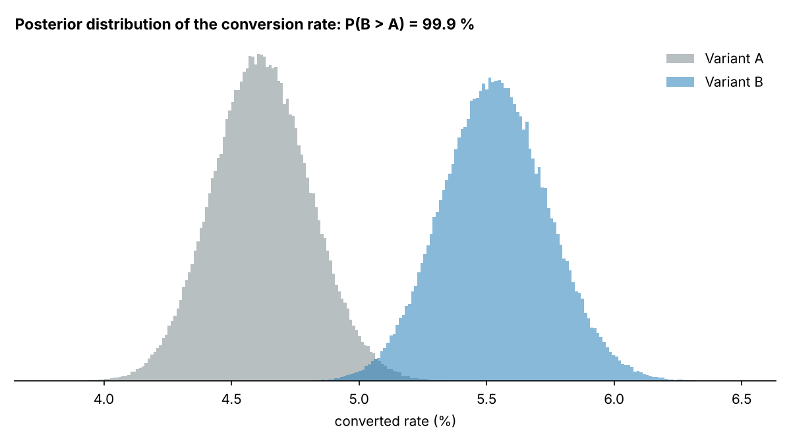
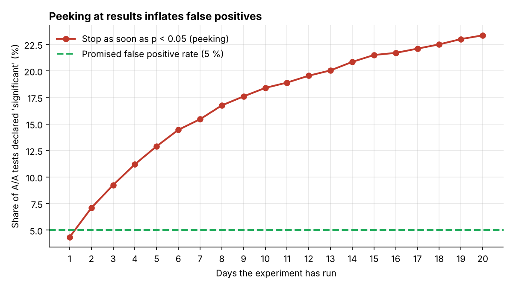

# A/B Test Analyzer

A Python toolkit and command-line tool for **planning and analysing online experiments** (A/B tests)
the way a data-driven business should. It covers frequentist and Bayesian methods, and it guards
against the most common mistakes: a broken traffic split, peeking at results early, and
over-reading segment results.

```bash
python -m abtest analyze data/checkout_experiment.csv --revenue revenue_sek --segment device
```

→ produces a full Markdown report: [`docs/report.md`](docs/report.md)



## Features

| Question | Method | Function |
|---|---|---|
| Did the conversion rate change? | Two-proportion z-test + confidence interval | `two_proportion_ztest` |
| Did revenue per user change? | Welch's t-test (unequal variances) | `welch_ttest` |
| How sure are we that B is better? | Beta-Binomial Bayesian model (Monte Carlo) | `bayesian_proportions` |
| Is the traffic split broken? | Chi-square sample ratio mismatch (SRM) test | `srm_check` |
| How many users do we need? | Sample size and power for two proportions | `sample_size_proportions`, `power_proportions` |
| Why not stop as soon as p < 0.05? | A/A test simulation | `peeking_false_positive_rate` |

## Example: one-page checkout experiment

An online shop tests a simplified one-page checkout (B) against the current multi-step checkout (A).
The dataset has 24,000 users and is synthetic: run `python -m abtest.sample_data` to regenerate it.

| | A (control) | B (one-page) |
|---|---:|---:|
| Users | 11,971 | 12,029 |
| Conversion rate | 4.61 % | 5.53 % |
| Revenue per user | 32.65 SEK | 39.06 SEK |

* **+0.92 percentage points** (95 % CI +0.36 to +1.47), relative lift **+19.9 %**, p = 0.0012
* Bayesian: **P(B > A) = 99.9 %**, 95 % credible interval for lift +7.4 % to +33.8 %
* Revenue per user +6.41 SEK (95 % CI +1.81 to +11.00), p = 0.006
* Traffic split healthy (SRM p = 0.71) → **Recommendation: ship B**

## Plan before you test

```bash
$ python -m abtest plan --baseline 0.05 --mde 0.10 --relative --daily 1200
Baseline rate 5.00 % -> target 5.50 %  (alpha 0.05, power 80%)
Users needed per group: 31,234   total: 62,468
At 1,200 users/day across both groups: about 53 days
```

Small effects need a lot of traffic. Knowing this *before* starting stops teams from ending
tests too early.

## The peeking problem

```bash
$ python -m abtest peeking
False positive rate, one look at the end: 5.1 %
False positive rate, peeking daily (20 days): 23.4 %
```



The simulation runs 2,000 A/A tests, where both groups are identical. If you check every day and
stop as soon as p < 0.05, almost **1 in 4** "winning" tests is a false alarm, not the promised
1 in 20. The fix is to fix the sample size in advance, or to use sequential testing methods built
for repeated looks.

## Use as a library

```python
from abtest import two_proportion_ztest, bayesian_proportions, sample_size_proportions

r = two_proportion_ztest(conv_a=552, n_a=11971, conv_b=665, n_b=12029)
print(r.rel_lift, r.p_value, r.ci_low, r.ci_high)

b = bayesian_proportions(552, 11971, 665, 12029)
print(b.prob_b_better)

print(sample_size_proportions(baseline=0.10, mde=0.02))   # 3841 per group
```

## Project structure

```
abtest/
  stats.py         statistical tests, power and sample size, Bayesian model
  simulate.py      peeking (A/A) simulation
  cli.py           analyze / plan / peeking commands, Markdown report
  sample_data.py   synthetic checkout experiment
data/              example experiment CSV
docs/              generated report and charts
tests/             pytest suite (10 tests): results are checked against SciPy and textbook values
```

## Install and test

```bash
git clone https://github.com/Tawuf/ab-test-analyzer.git
cd ab-test-analyzer
pip install -r requirements.txt
pytest -q
```

## Author

**Md Tawuf Chowdhury**: MSc Information Systems, Uppsala University.

License: MIT
