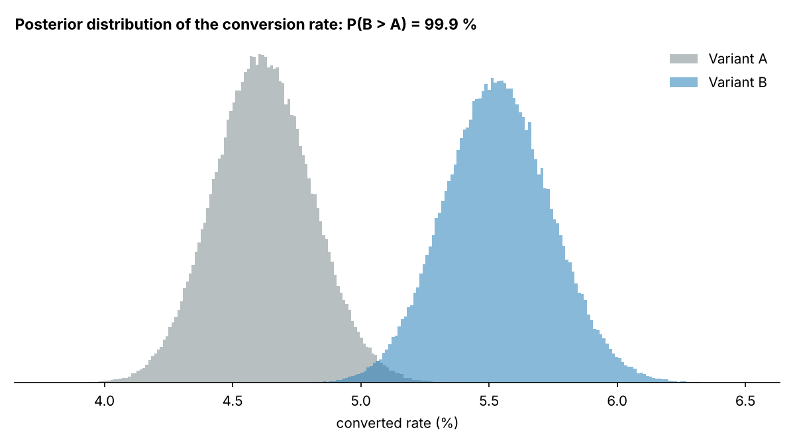

# A/B test report: `checkout_experiment.csv`

## 1. Sanity check: sample ratio

A: 11,971 users, B: 12,029 users. SRM chi-square p = 0.708. **Traffic split looks healthy.**

## 2. Primary metric: `converted` rate

| | Control | Treatment |
|---|---:|---:|
| Group | A | B |
| Rate | 4.61 % | 5.53 % |

* Absolute difference: **+0.92 percentage points** (95 % CI +0.36 to +1.47)
* Relative lift: **+19.9 %**
* z = 3.24, p = 0.0012, so the result is **statistically significant** at α = 0.05
* Bayesian view: P(B better than A) = **99.9 %**; 95 % credible interval for relative lift +7.4 % to +33.8 %; expected loss if we ship B: 0.0001 pp

## 3. Secondary metric: `revenue_sek` per user (Welch t-test)

* Mean A: 32.65, mean B: 39.06
* Difference +6.41 (95 % CI +1.81 to +11.00), p = 0.0063

## 4. Segments by `device` (exploratory)

| Segment | Control rate | Treatment rate | Lift | p-value |
|---|---:|---:|---:|---:|
| desktop | 5.69 % | 6.91 % | +21.4 % | 0.017 |
| mobile | 3.96 % | 4.69 % | +18.6 % | 0.027 |

*Segment results are exploratory. Testing many segments raises the chance of a false positive, so confirm any segment finding in a new experiment.*

## Recommendation

**Ship the treatment.**
